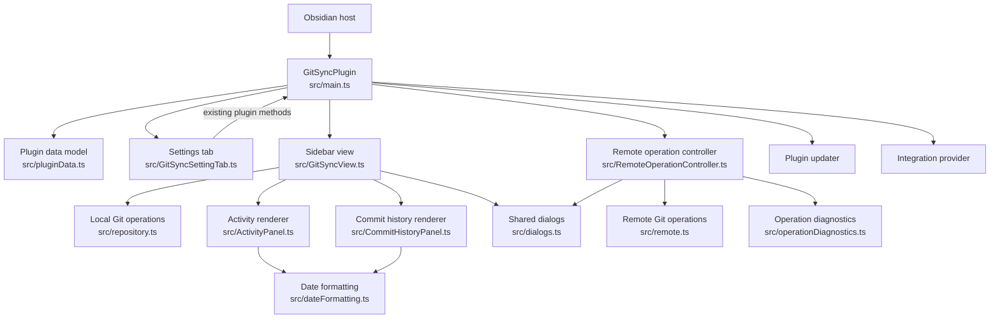
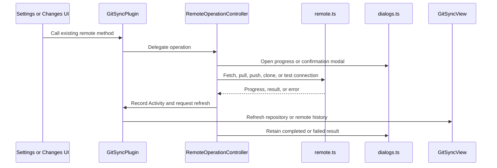

# Code Quality, Review, and Modularity

*Last Updated: 2026-10-31 15:06:54 IST*

This document tracks the ongoing T14 code-quality task and the behavior-preserving
module extraction started on `codex/main-ts-modularity`. It records current
ownership and the remaining decomposition work; it does not claim installed-host
acceptance.

## Refactor Summary

The original `src/main.ts` was 3,547 lines at the branch base. The first
extraction reduced it to 428 lines. T16 registry, persistence, and repository
context work has since expanded the composition module to 615 lines; it still
coordinates plugin lifecycle, selected repository state, persistence, and
integrations. Data normalization, Settings UI, sidebar view, remote-operation
queuing, dialogs, diagnostics, and focused Activity/Commits rendering remain in
separate modules.

The extraction is intended to preserve existing behavior and presentation.
Feature ownership remains with the existing components: the view still manages
repository state and Changes interactions; the plugin still owns persisted
settings and Activity state; remote Git mechanics remain in `src/remote.ts` and
`src/repository.ts`.

On 2026-10-31, selected paths and per-section range anchors moved into
`src/ChangeSelection.ts`. Pure stage-result and path-refresh snapshot updates
moved into `src/ChangeListState.ts`. The view still owns DOM event handling,
repository refresh, and Git operations; the extracted helpers can be tested
without Obsidian DOM.

A source-level review of `GitSyncView` found four responsibilities sharing one
class: Obsidian view/background-event lifecycle, repository and Changes
refresh, Changes UI and file actions, and commit-history loading/cache/paging.
The history extraction now belongs with T16c, when commits become
repository-scoped. Changes display and refresh ownership follow the seams
needed by T16/T17 features, with explicit inputs and callbacks. T14 remains the
review and module-map owner; this work is not a separate prerequisite for T16a.

## Component Map

| Module | Responsibility | State and operation owner |
|---|---|---|
| `src/main.ts` | Plugin lifecycle, view registration, settings and Activity persistence, plugin API registration, updater wiring, and view-refresh callbacks | `GitSyncPlugin` coordinates plugin-wide state and exposes the existing entry points |
| `src/pluginData.ts` | Settings/activity types, repository registry and schema migration, defaults, normalization, merging, and line serialization | Pure data helpers; persisted state remains in `GitSyncPlugin` |
| `src/repositoryPaths.ts` | Canonical vault-relative repository/file path normalization and root-overlap checks | Pure path rules shared by registry, local Git, remote Git, and coordinator |
| `src/RepositoryMutationCoordinator.ts` | Serializes mutations per root, blocks overlapping roots, allows sibling roots concurrently | Shared coordinator used by local/remote operations and UI busy checks |
| `src/GitSyncSettingTab.ts` | Obsidian Settings UI, import/export controls, and setting callbacks | UI stays in the Settings tab; persistence and operations are delegated to the plugin |
| `src/GitSyncView.ts` | Sidebar tabs, repository picker, Changes DOM/actions, repository reads, staging/commit, local branches, index restore, background refresh, and history data loading | View owns current repository/view state and async generations; repository writes use the shared coordinator |
| `src/ChangeSelection.ts` | Selected changed-file paths, section range anchors, range selection, and pruning paths no longer present | Selection model owns path-selection state; the view supplies visible paths and renders the result |
| `src/ChangeListState.ts` | Pure updates to the Changes snapshot after staging or path-scoped refresh | Stateless helpers return a new snapshot; the view owns the resulting snapshot |
| `src/ActivityPanel.ts` | Renders Activity rows and the Load More control | Stateless renderer; entries and visible count come from the plugin/view |
| `src/CommitHistoryPanel.ts` | Renders Local/Remote history, commit rows, details, and empty/loading/error states | Stateless renderer; history queries, paging, and lazy detail loading stay in `GitSyncView` |
| `src/RemoteOperationController.ts` | Queues remote actions, builds operation options, reports progress/results, and requests view refreshes | Controller uses a host interface supplied by `GitSyncPlugin` |
| `src/dialogs.ts` | Confirmation, `.gitignore` editor, and remote progress/result modals; remote-message sanitizing | Dialog classes own modal presentation, not repository state |
| `src/operationDiagnostics.ts` | Elapsed-time formatting and nested operation-error descriptions | Pure formatting/diagnostic helpers |
| `src/dateFormatting.ts` | Activity and commit timestamp presentation | Pure date-formatting helpers |
| `src/repository.ts`, `src/remote.ts` | Local repository and remote Git operations | Existing Git operation modules; the UI/controller call these directly |
| `src/updater/PluginUpdater.ts`, `src/integrationProvider.ts` | Update checks/install flow and integration-provider API | Existing feature modules wired by `GitSyncPlugin` |

## Plugin Composition and Data Flow



## GitSyncView Ownership Review and Refactoring Plan

The current problem is that unrelated state and work share one class. The
diagram shows those responsibilities in the source today; it does not suggest
that every box should become a new file.

### Current source structure

```text
GitSyncPlugin (src/main.ts, 615 lines)
|
+-- creates and calls GitSyncView (src/GitSyncView.ts, 2,328 lines)
    |
    +-- Obsidian view lifecycle, tabs, and repository header
    +-- vault events, background refresh queue, and timer
    +-- repository inspection and Changes refresh/reconciliation
    +-- Changes tree, rows, filters, selection events, and file actions
    +-- stage/unstage, commit, and post-mutation refresh
    +-- commit-history reads, paging, detail cache, and loading/error state
    +-- Activity and commit panel wiring
    |
    +-- captures selected repository contexts for remote/provider operations
    +-- calls src/repository.ts for local Git reads and writes
    +-- uses src/RepositoryMutationCoordinator.ts for overlapping write safety
    +-- uses src/repositoryPaths.ts for root and path normalization
    +-- uses src/ChangeSelection.ts for selected paths and range anchors
    +-- uses src/ChangeListState.ts for pure Changes snapshot updates
    +-- renders src/ActivityPanel.ts and src/CommitHistoryPanel.ts
    +-- calls plugin methods for settings, Activity, and remote actions

Other callers:
  GitSyncPlugin callbacks ------> refreshRepositoryState / refreshRemoteHistory
  Integration provider --------> refreshIntegrationStage
```

The `CommitHistoryPanel` and `ActivityPanel` only render. Their data loading or
visible-count state still belongs to `GitSyncView`. The two Changes helper files
already hold the small state operations that can be tested without Obsidian DOM.

### Intended structure, in stages

```text
GitSyncPlugin (src/main.ts)
|
+-- GitSyncView (Obsidian lifecycle, tab shell, and composition)
    |
    +-- CommitHistoryController [first]
    |   +-- local/remote history state and reads
    |   +-- paging and lazy commit-detail cache
    |   +-- loading/errors and repository/branch reset
    |
    +-- ChangesPanel [second]
    |   +-- folder tree, rows, filters/sort, focus/scroll rendering
    |   +-- sends user actions to callbacks; does not run Git writes
    |
    +-- RepositoryRefreshController [third]
    |   +-- repository inspection and full/path-scoped Changes reads
    |   +-- refresh generation and snapshot reconciliation
    |
    +-- ChangeSelection and ChangeListState [existing]
    +-- ActivityPanel and CommitHistoryPanel [existing renderers]
    +-- stage/commit actions and user-facing notices [remain in view initially]
```

The proposed controllers should receive the repository path, branch, adapter,
and narrowly scoped callbacks as arguments. They should not reach into view DOM
or depend on the full `GitSyncPlugin` object. The view remains responsible for
Obsidian lifecycle and presenting the returned state.

### Repository and Changes refresh flow

```text
Manual refresh / vault event / integration-stage update
                         |
                         v
                    GitSyncView
                         |
          RepositoryRefreshController [planned]
               |                       |
               v                       v
        full refresh               known paths
               |                       |
               v                       v
 inspectLocalRepository       readChanges(paths)
               |                       |
 readChanges(all paths)                |
               +-----------+-----------+
                           |
                  check generation and repo
                           |
                     discard stale result
                           |
                 accept current result
                    |             |
                    v             v
             full snapshot   ChangeListState
                    |             |
                    +------+------+
                           |
                           v
 GitSyncView prunes ChangeSelection and updates ChangesPanel
```

Full scans remain for explicit refreshes or when the current snapshot is
uncertain. Background events and integration staging stay path-scoped when the
affected paths are known. Generation checks must continue to prevent an older
async read from replacing newer state.

### Commit-history flow

```text
User opens Commits / chooses source / loads more / opens a commit
                              |
                              v
                         GitSyncView
                              |
                              v
                  CommitHistoryController
                    |                 |
                    v                 v
             readCommits()     readRemoteCommits()
                    |                 |
                    +------ state ----+
                              |
                pages, errors, detail cache
                              |
                     state snapshot to view
                              |
                              v
                    CommitHistoryPanel
```

### Implementation order and checks

1. **Commit history with T16c:** move history state and reads behind a small
   controller when history becomes repository-scoped. Keep selection of the
   displayed source and DOM callbacks in the view unless implementation shows
   they belong with history state. Test paging, repository/ref resets, lazy
   details, failures, and stale results.
2. **Changes presentation as needed:** move DOM construction and filter/sort display
   into a panel with explicit data and callbacks. Keep Git writes, Activity
   reporting, Notices, and refresh policy outside that renderer. Verify folder
   actions and selection continue to use visible paths.
3. **Repository refresh with isolation:** move inspect/read/reconcile work
   behind a controller when T16/T17 needs repository-aware refresh state, after
   generation and cancellation-on-close rules are covered. Keep
   `ChangeSelection` responsible for selected paths and prune them after a new
   snapshot is accepted.
4. **Remaining lifecycle and mutations:** review background event batching and
   stage/commit actions only after the first three owners are clear. Leave a
   group in `GitSyncView` if extracting it would just pass shared mutable state
   back and forth.

Each step should preserve the plugin and integration-provider entry points,
keep Git mechanics in `repository.ts`/`remote.ts`, and update this map only when
ownership actually changes.

## Remote Operation Sequence



## Current Boundaries and Remaining Work

- `GitSyncPlugin` remains the composition point. Settings and remote UI continue
  to call its existing methods; the refactor adds collaborators behind those
  methods instead of changing the feature API.
- `RemoteOperationController` receives a narrow host interface for settings,
  credentials, Activity, and view refreshes. Remote transport remains in
  `src/remote.ts`.
- `ChangeSelection` owns selected paths and per-section range anchors.
  `GitSyncView` translates mouse/touch input, applies visible folder/selection
  actions, reconciles paths after refreshes, and clears selected paths after
  staging or uncertain changes.
- `ChangeListState` owns two pure snapshot transformations: applying a known
  stage result and replacing refreshed paths. The view owns the current list.
- `pluginData.ts` stores schema-v2 repository definitions and the selected
  repository ID. The sidebar can select, add/open, initialize, and clone repos;
  remote and integration calls capture repository-specific settings/credentials.
- `repositoryPaths.ts` owns canonical root and file-path rules.
- `RepositoryMutationCoordinator.ts` serializes same-root writes, prevents
  overlapping-root writes, and permits sibling repository mutations concurrently.
- `GitSyncView` is 2,328 lines and still combines view lifecycle, repository
  refresh, Changes interaction/actions, and commit-history data handling. The
  ownership review is complete; the staged plan above starts with the history
  data controller. Repository-switch generation checks and operation guards
  were added, but history ownership has not moved yet.
- The Settings tab, plugin-data model, dialogs, Activity renderer, and commit
  renderer have separate files. Their data/loading ownership is intentionally
  still in the plugin or view where it was before the extraction.
- `server.js` is part of mb-core and is excluded from this repository's scope.

## Verification and Limits

- The initial extraction passed `pnpm build` and `git diff --check` on 2026-10-05.
- `pnpm test` passed 25 tests and the production build on 2026-10-31. New tests
  cover registry migration, mutation coordination, two local repositories,
  provider IDs, branch switching, index restore, nested boundaries, and paths.
- The running Obsidian 1.14.5 window still uses the earlier plugin build.
  Installed-host behavior for this source set, including its new controls,
  remains unverified.
- No `GitSyncView` extraction was made in this pass. Commit history remains in
  the view; Changes presentation and refresh extraction remain tied to feature
  seams with focused stale-result tests.
- Build success confirms TypeScript and bundling only; runtime behavior remains
  unverified on the Obsidian host.
