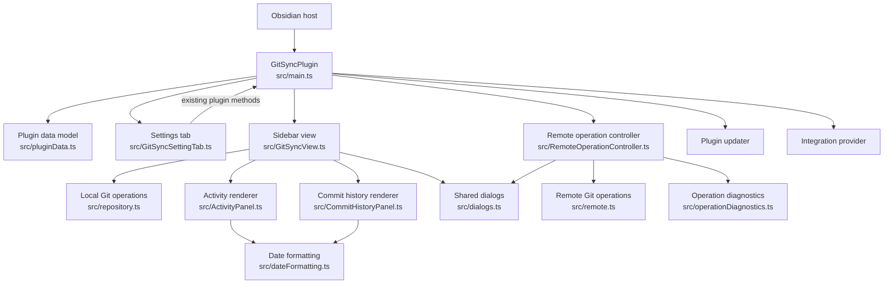
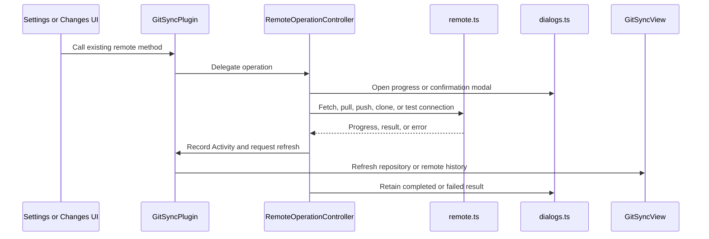

# Code Quality, Review, and Modularity

*Last Updated: 2026-10-05 14:19:36 IST*

This document tracks the ongoing T14 code-quality task and the behavior-preserving
module extraction started on `codex/main-ts-modularity`. It records current
ownership and the remaining decomposition work; it does not claim installed-host
acceptance.

## Refactor Summary

The original `src/main.ts` was 3,547 lines at the branch base. After extraction,
it is 428 lines and serves as the Obsidian plugin coordinator. The first pass
moved data normalization, Settings UI, the sidebar view, remote-operation
queuing, dialogs, diagnostics, and focused Activity/Commits rendering into
separate modules.

The extraction is intended to preserve existing behavior and presentation.
Feature ownership remains with the existing components: the view still manages
repository state and Changes interactions; the plugin still owns persisted
settings and Activity state; remote Git mechanics remain in `src/remote.ts` and
`src/repository.ts`.

## Component Map

| Module | Responsibility | State and operation owner |
|---|---|---|
| `src/main.ts` | Plugin lifecycle, view registration, settings and Activity persistence, plugin API registration, updater wiring, and view-refresh callbacks | `GitSyncPlugin` coordinates plugin-wide state and exposes the existing entry points |
| `src/pluginData.ts` | Settings/activity types, defaults, decoding, normalization, merging, and line serialization | Pure data helpers; persisted state remains in `GitSyncPlugin` |
| `src/GitSyncSettingTab.ts` | Obsidian Settings UI, import/export controls, and setting callbacks | UI stays in the Settings tab; persistence and operations are delegated to the plugin |
| `src/GitSyncView.ts` | Sidebar tabs and repository context; repository reads, Changes selection/staging/commit, background refresh, and Commits/Activity data loading | Main view currently owns shared repository/view state and most Changes behavior |
| `src/ActivityPanel.ts` | Renders Activity rows and the Load More control | Stateless renderer; entries and visible count come from the plugin/view |
| `src/CommitHistoryPanel.ts` | Renders Local/Remote history, commit rows, details, and empty/loading/error states | Stateless renderer; history queries, paging, and lazy detail loading stay in `GitSyncView` |
| `src/RemoteOperationController.ts` | Queues remote actions, builds operation options, reports progress/results, and requests view refreshes | Controller uses a host interface supplied by `GitSyncPlugin` |
| `src/dialogs.ts` | Confirmation, `.gitignore` editor, and remote progress/result modals; remote-message sanitizing | Dialog classes own modal presentation, not repository state |
| `src/operationDiagnostics.ts` | Elapsed-time formatting and nested operation-error descriptions | Pure formatting/diagnostic helpers |
| `src/dateFormatting.ts` | Activity and commit timestamp presentation | Pure date-formatting helpers |
| `src/repository.ts`, `src/remote.ts` | Local repository and remote Git operations | Existing Git operation modules; the UI/controller call these directly |
| `src/updater/PluginUpdater.ts`, `src/integrationProvider.ts` | Update checks/install flow and integration-provider API | Existing feature modules wired by `GitSyncPlugin` |

## Plugin Composition and Data Flow

## Remote Operation Sequence

## Current Boundaries and Remaining Work

- `GitSyncPlugin` remains the composition point. Settings and remote UI continue
  to call its existing methods; the refactor adds collaborators behind those
  methods instead of changing the feature API.
- `RemoteOperationController` receives a narrow host interface for settings,
  credentials, Activity, and view refreshes. Remote transport remains in
  `src/remote.ts`.
- `GitSyncView` remains 2,061 lines. It still combines the sidebar shell,
  repository refresh lifecycle, and most Changes interaction/rendering and
  mutation behavior. This is the next review target; split it only after
  tracing shared selection, refresh, and staging state.
- The Settings tab, plugin-data model, dialogs, Activity renderer, and commit
  renderer have separate files. Their data/loading ownership is intentionally
  still in the plugin or view where it was before the extraction.
- `server.js` is part of mb-core and is excluded from this repository's scope.

## Verification and Limits

- `pnpm build` passed after the source extraction.
- `git diff --check` passed.
- No tests or installed Obsidian desktop/mobile checks were run for this pass.
- Build success confirms TypeScript and bundling only; runtime behavior remains
  unverified on the Obsidian host.
